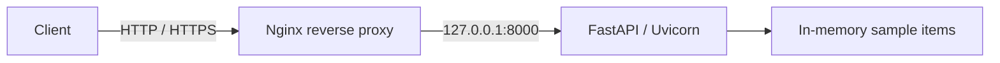

# Secure API Infrastructure

A hands-on DevOps project covering a protected FastAPI service, Ubuntu deployment behind Nginx, backup automation, and a separate AWS VPC networking lab. Domain and Cloudflare setup are planned but not configured yet.

## Current status

- The API runs on an Ubuntu virtual machine as a systemd service behind Nginx.
- HTTPS on the Ubuntu lab uses a self-signed certificate for local-network testing.
- The test suite contains nine API tests; all nine passed in the latest recorded run.
- A daily backup is scheduled with cron. The script has passed a manual run; the next scheduled run still needs verification. Backups contain project files, including `.env`, and must remain access-restricted.
- The AWS networking lab is separate from the Ubuntu API deployment. Its EC2 instance is stopped.
- Cloudflare, custom-domain DNS, and trusted public TLS are future work.

## Architecture



The AWS directory also documents a conceptual three-tier production design with a public load balancer, private application tier, and private database tier. Those tiers have not been created in AWS.

## API

| Method | Path | Access | Description |
|---|---|---|---|
| `GET` | `/` | Public | Health and welcome response |
| `GET` | `/items` | API key | Paginated sample items (`page`, `limit`) |
| `POST` | `/items` | API key | Validates and returns an item |

Protected routes use the `X-API-Key` header. The sample data is in memory and is not a persistent database.

Security and reliability features include:

- Pydantic request and response validation.
- Rate limit of five requests per minute per client IP on item routes.
- Request-body limit of 1 MiB.
- Configurable trusted hosts, generic internal error responses, and request logging.
- CORS for local development origins `http://localhost:3000` and `http://127.0.0.1:3000`.
- API docs and OpenAPI endpoints disabled.
- Response headers for content type, framing, referrer policy, content security policy, and permissions policy.

## Run locally

Requirements: Python 3 and Git. The Ubuntu lab was tested with Python 3.12.

```bash
git clone https://github.com/umararshad0/secure-api-infrastructure.git
cd secure-api-infrastructure
python3 -m venv .venv
source .venv/bin/activate
pip install -r requirements.txt
cp .env.example .env
```

Edit `.env` and replace the example `API_KEY` with a strong secret. Generate one with:

```bash
python -c 'import secrets; print(secrets.token_urlsafe(48))'
```

Set `ALLOWED_HOSTS` to the hostnames used to access the service. `FORCE_HTTPS` defaults to `false`; enable it only when HTTPS and proxy handling are configured.

Start the development server:

```bash
uvicorn api.main:app --reload
```

The CORS origins are currently defined in `api/main.py`; update them deliberately when adding a frontend origin.

## Tests

```bash
python -m pytest -v
```

The nine tests cover the home route, API-key authentication, pagination, validation, rate limiting, and item creation. To check dependencies for known vulnerabilities, run `pip-audit -r requirements.txt`.

## Ubuntu deployment

The scripts target the existing Ubuntu lab server. `deployment/setup-server.sh` installs prerequisite packages but does not configure the firewall, secrets, Nginx, or systemd.

`deployment/deploy.sh` pulls `main`, installs requirements, runs tests, restarts `secure-api`, and checks the service state. It expects the repository, virtual environment, environment file, systemd unit, and Nginx configuration to be set up already.

`deployment/backup.sh` creates and verifies timestamped archives, retaining the seven newest. See `deployment/README.md` for setup, deployment, service management, rollback, and troubleshooting instructions.

Useful checks:

```bash
sudo systemctl status secure-api nginx --no-pager
sudo journalctl -u secure-api -n 50 --no-pager
sudo nginx -t
```

Backups include `.env`. Restrict access to backup files and encrypt them before placing copies in remote storage.

## AWS networking lab

The lab is in Europe (Stockholm), `eu-north-1`:

- VPC CIDR: `10.0.0.0/16`.
- Public subnet: `10.0.1.0/24`; private subnet: `10.0.2.0/24`. Both are in the same Availability Zone.
- Public default route uses an Internet Gateway. The private route table has no NAT Gateway route.
- Security group notes restrict SSH to the administrator's `/32`, allow HTTP/HTTPS, and do not expose port 8000.
- Configuration screenshots are in `aws/screenshots/`; the lab EC2 instance is stopped.

See `aws/networking-notes.md`, `aws/security-groups.md`, and `aws/architecture-diagram.md`. Port 443 is allowed by the AWS security group, but TLS was not configured on the AWS lab instance.

## Security notes

- The Ubuntu VM's self-signed certificate is for local testing, not public production use. `curl -k` disables certificate verification.
- The AWS lab and Ubuntu API server are separate environments.
- Never commit `.env`, API secrets, private keys, certificates, or backup archives.
- Before public deployment, configure a domain, trusted TLS certificate, Cloudflare DNS/proxy, and production CORS and host allow lists.

## Repository layout

```text
api/                 FastAPI application
aws/                 VPC notes, architecture, and screenshots
deployment/           Setup, deploy, backup scripts, and deployment guide
tests/                API tests
.env.example          Example environment configuration
requirements.txt      Python dependencies
```

## Next steps

- Configure domain DNS, Cloudflare proxy, and trusted HTTPS.
- Document the actual Cloudflare settings under `cloudflare/`.
- Run final domain-based security and connectivity checks.
- Complete the final security and GitHub repository review.
