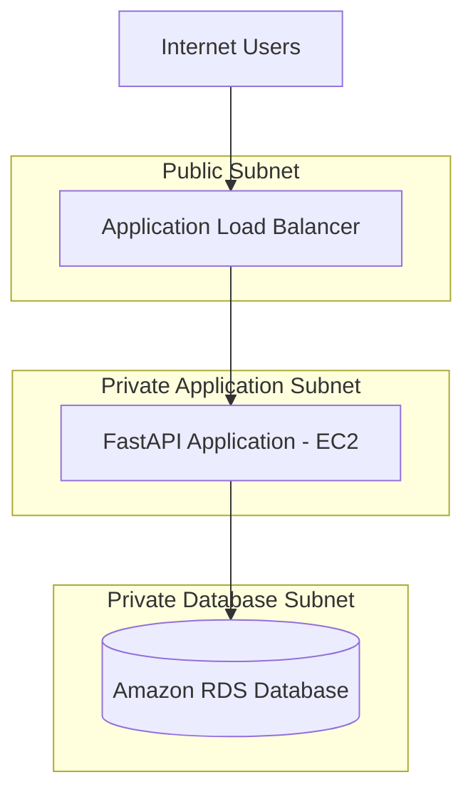

# AWS Three-Tier Architecture

This diagram illustrates a recommended production architecture for Secure API Infrastructure.

## Architecture layers

1. **Presentation tier:** Application Load Balancer receives public traffic.
2. **Application tier:** FastAPI runs on EC2 in a private subnet.
3. **Database tier:** Amazon RDS runs in private database subnets.

## Security principles

- Do not expose the database directly to the internet.
- Allow application traffic only from authorized sources.
- Restrict database access to the application tier.
- Use security groups to control communication between tiers.

## Important note

This is a conceptual production architecture. The current AWS lab uses one public subnet and one private subnet. We have not created an additional application or database tier.
